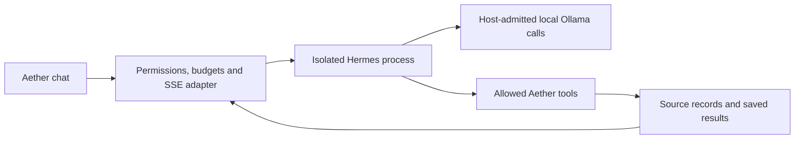

# Hermes integration and photo editing — proposed next checkpoints

**H0 scope approved, 17 October:** Jake approved the isolated named dependency,
64K profile and bounded comparison. His subsequent phone reply was “I haven’t
checked yet”; installation/native execution await that prerequisite. Preparation
and current limitations are in `HERMES-H0-PREPARATION-REPORT.md`. The original
scope, call ceiling and quality criteria below remain unchanged.

17 October 2026. Jake requested these capabilities and made Hermes the next
priority after fixes, merge and rename. The QA repair release is complete;
physical phone acceptance is pending. This document is a researched proposal,
not an installation, native trial or product qualification.

## Recommended order

1. Close the repair release's phone check and fix any reported regression.
2. **H0: qualify an isolated Hermes integration** with the existing local models.
3. **H1: connect qualified Hermes execution to Aether** on a separate branch.
   Keep Aether's chat, attachment UI, storage and streaming; reuse Hermes' agent
   loop. Review before publication.
4. **PE0/PE1: reference-photo editing**, first a bounded worker/quality test, then
   the chat attachment flow. It remains its own image pipeline, available to
   Hermes later through the same admitted image-job API if separately approved.
5. Extend workflow blocks and then consider routing when task-specific results
   justify it. Preserve the existing manual workflow engine and saved graphs.

This replaces the proposed next custom read-only chat-agent implementation with
a Hermes-first feasibility checkpoint. It does not restart the shelved Research
implementation or reopen its failed qualification as a passed gate.

## What Hermes supplies, and what Aether still owns

Hermes Agent is Nous Research's agent software, not an image model or a mandatory
new set of model weights. Its official guide supports Ollama; its API exposes
streamed execution and run/cancellation capabilities. Its Python library also
allows explicit toolsets. [Local setup](https://hermes-agent.nousresearch.com/docs/guides/local-ollama-setup),
[API server](https://hermes-agent.nousresearch.com/docs/user-guide/features/api-server),
[library integration](https://hermes-agent.nousresearch.com/docs/guides/python-library).

Recommendation: an isolated Hermes process behind a small Aether server adapter.
Use the stable release's supported API/run event contract, selected by its actual
capabilities; keep its service private to the Mac. No browser-to-Hermes credential
or Tailscale change. Its dependencies remain outside the application and image/
transcription environments. This avoids coupling the app's Python packages to
Hermes' dependency graph or replacing the interface the user chose.

Aether retains admission/Capacity serialization, cancellation, session ownership,
source records, transcript/image storage rules, UI and permission decisions.
Every Hermes inference request, including retries or auxiliary work, must pass
the same admission boundary and count toward the trial budget. A direct hidden
Ollama connection that bypasses image/transcription scheduling is unacceptable.
Native-call tracing and cancellation proof are required before product wiring.

Ordinary chat stays on its current path. The UI must make delegated execution
explicit; no silent rerouting of every message to an agent. Select that small
entry interaction at H1 review, with every state represented on /design.

## H0: concrete isolated trial proposal

### Named candidate and known constraints

- **Hermes Agent v0.22.2**, published 15 October, source commit
  `d923a5eb487a17c0a68801bba9ef0f56c81040a8`. Use this release, not moving main
  or the superseded v0.22.1. [Official release](https://github.com/NousResearch/hermes-agent/releases/tag/v0.22.2).
- Its pinned project declares Python `>=3.11,<3.15`; freeze an isolated environment
  and resolved dependency inventory before inference. No global installer,
  shell-profile change, app environment mutation, automatic updater or optional
  package extras by default. Source metadata/hash is retained in
  `artifacts/qa-roadmap/release-20261017/hermes-source-review.json`.
- The local guide explicitly calls for **at least 64,000 context tokens** for
  tool use, including in the pinned release's source. Our daily profile is 32K.
  This is a measured compatibility/resource question for the trial, not a reason
  to silently increase production context or relax existing image limits.
  [Pinned guide](https://github.com/NousResearch/hermes-agent/blob/d923a5eb487a17c0a68801bba9ef0f56c81040a8/website/docs/guides/local-ollama-setup.md).
- A 64K test profile would reuse existing weights but still needs explicit
  profile/native-trial approval and host measurements. Its coexistence with
  images is **unqualified**: the current qualified 32K combination cannot be
  generalized to it. No model unload or default switch is implicit.

Current live docs may be ahead of the release. The stable tree contains API/run,
capability, toolset and cancellation sources, but their actual behavior must be
probed; documentation alone is not a compatibility pass.

### Installation and structural stage

After approval of the named source/dependency scope, create an isolated branch,
environment, profile and synthetic workspace. Resolve/freeze dependencies and
record storage before running anything. Preserve main/live and all prior evidence.
First use scripted inference to test the adapter, without native model calls:

- SSE ordering/reconnect, stable run IDs, terminal status and cancellation.
- Exact explicit sampling/default behavior; reject unsupported values rather
  than let a framework silently substitute its own sampling settings.
- Tool allowlist and host arguments, bounded retries, no cross-chat memory leak,
  no image/chat scheduler bypass, no work continuing after cancellation.
- No cloud fallback/auxiliary provider, hosted memory, telemetry export,
  automatic skill creation, background schedule, sub-agent, arbitrary shell or
  filesystem access. Isolate HERMES_HOME and context files; inspect effective
  configuration and outgoing requests rather than trusting a disabled-tool label.

Initially expose only web search, page reading, a synthetic Library and a bounded
calculator through controlled adapters. Reuse free search providers. Do not
assume Hermes' default web/image integrations use the current app's free services.
Do not share real Library files, uploaded photos or recordings during qualification.

### Proposed native budget and acceptance, subject to review

Freeze six representative tasks and expected facts before inference: source
comparison, a document question, exact calculation, a short multi-step task, a
malicious-source refusal and an unsupported-information refusal. Use separate
development fixtures; do not tune against the qualification tasks.

Proposed ceiling: six direct comparison answers plus two Hermes runs of each
task, **at most three model calls per delegated task**: at most **42 native calls**
in total. Count retries and hidden auxiliary calls; no extra attempts. Enforce
180 seconds per task, a source-text budget and host-side tool argument limits.
Begin with one smoke; a protocol, permission, unsupported-claim or host-resource
failure stops the stage before the remainder. No moving prompts/models during
the frozen repeat. These are proposed limits, not already approved inference.

For a feasible H1 candidate: all six tasks complete correctly in both series;
zero unauthorized execution or fabricated material facts; all cited references
resolve to retained evidence with manual claim review; cancellation reaps work;
no default/sampling mutation or extra uncounted inference. Record actual latency,
peak memory, swap, first-load cost and output completeness, including failures.
Do not promote on tool-call syntax alone or on one favorable run. A failed trial
ends with a recommendation; it does not start another open-ended prompt campaign.

Framework reuse can save orchestration work. It cannot guarantee that the same
local model will reason faster or ground facts better. Production integration
requires broader held-out quality/injection and existing release gates after H0;
this small feasibility test is not a general reliability claim.

## Photo editing: what the user would do

Attach a photo in the existing composer and type an instruction, for example
“change the background and keep the person the same.” An explicit **Edit image**
selection uses that upload as the reference. The reply is an image card in the
same conversation with Save, compare/original and version actions. Seed selection
stays automatic; advanced settings remain optional.

Reference editing uses an image model conditioned on pixels plus instructions.
A text/vision model that describes a photo is a different operation. The existing
FLUX.2 klein family supports image-conditioned editing.
[MFLUX reference editing](https://github.com/mflux-community/mflux/blob/main/src/mflux/models/flux2/README.md).

### Existing foundation

The installed MFLUX 0.22.0 / FLUX.2 klein 4B weights are the first candidate; do
not upgrade MFLUX or download a larger model merely because current docs show one.
Our I0 trial already completed one reference edit. The isolated edit worker uses
`Flux2KleinEdit` and `image_paths`; the production worker currently creates images
from text only. Today's prompt Refine/More like this and parent IDs do not feed
the previous photo to that worker. See `IMAGE-TRIAL-REPORT.md`,
`image_worker/memory/worker.py` and `image_worker/product/worker.py`.

That one edit establishes an available code path, not portrait likeness quality,
pixel preservation or comfortable mixed-model memory. It is not exposed in chat.

### PE0/PE1 acceptance scope

1. Wire explicit owned reference IDs to private, validated image input. Reuse
   upload normalization, orientation, dimensions and format guards. No arbitrary
   file paths/URLs or silent text-only fallback. Validate PNG/JPEG and supported
   HEIC conversion with synthetic inputs.
2. Keep originals immutable, separate working copies and full output versions;
   record lineage and exact bytes. Removing a chat attachment must not leave an
   admitted job with a dangling reference or leak it across chats. Show retained
   originals, revisions and backup storage in existing storage controls.
3. Preserve truthful step progress, cancellation/reaping, restart recovery and
   the existing native scheduler. Measure edit-mode memory/latency before applying
   any generation-only residency qualification. No automatic model ejection.
4. Review requested changes and unwanted changes, especially face/likeness,
   pose, hands and background, across a small frozen set of synthetic/permitted
   images. Real personal photos stay private and out of repo evidence. Ask Jake
   to review quality before publication; no guaranteed identity preservation.
5. Keep the existing generation path, text-model image-turn exclusion and user
   sampling/prompt contracts tested. Use a separate reviewed migration only if
   references need new schema; never overload lineage as proof of pixel input.

Each revision is a full image, not a small Photoshop-style change file. The
earlier single edit was 1.38 MB including metadata; it is one observation, not a
size guarantee. The 15.98 GB model snapshot is shared, not duplicated per edit.
See `IMAGES-STORAGE.md` for measured storage and backup retention.

**Brush-selected editing is a later extension.** A mask can specify the area to
change, with deterministic compositing preserving original pixels outside that
area when appropriate. Whole-image reference editing alone cannot promise that.
Mask UI, suitable engine support and seam/pixel checks need their own scope.

## Review boundary

The release is authorized and complete; this plan reprioritization is authorized.
AGENTS.md still requires approval before named new dependencies or native trials.
Next decision: the isolated pinned Hermes H0 package/profile/call budget above.
No Hermes install, 64K profile, native agent call, new agent UI, photo edit or
additional image model is installed or executed by this research document.
