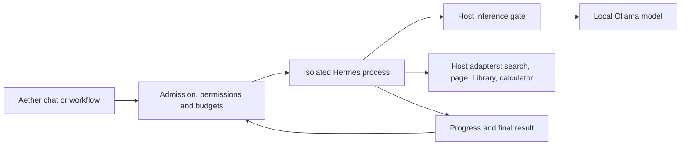

# Hermes with the installed local models

17 October 2026. Read-only compatibility analysis requested by Jake. No new
inference, dependency, profile, runtime setting or production change.

## Summary

**Yes: Hermes is a viable integration candidate for the installed local models.**
Its supported Ollama connection and the runtime's reported capabilities establish
a credible technical path. They do not establish end-to-end reliability. The
first H0 failure occurred before a model request: it tests our tool configuration,
not the intelligence or compatibility of Qwen3.8. Native H0 remains unqualified.

Use the existing models before considering another download. Complete the
configuration checks, then the original bounded Qwen3.8 qualification. Qwen 3
30B A3B is the strongest subsequent speed candidate in our retained protocol
evidence; Gemma 4 12B is the next smaller, vision-capable candidate. These are
recommendations for evaluation, not default switches or new native approvals.

## What is compatible

Hermes Agent is orchestration software. It can use other publishers' model
weights; installing a model named Hermes is not a prerequisite. The official
[Ollama setup guide](https://hermes-agent.nousresearch.com/docs/guides/local-ollama-setup)
supports a local OpenAI-compatible endpoint. Ollama documents tools and streaming
on [/v1/chat/completions](https://docs.ollama.com/api/openai-compatibility).
Those protocol features still require an actual round trip through the pinned
Hermes version and installed Ollama, including streamed tool arguments and IDs.

Fresh read-only inspection finds **Ollama 0.35.0**, an **Apple M5 Pro with
64 GiB unified memory**, and seven visible chat profiles from five model families.
Each reports both `completion` and `tools` through `/api/show`. Capabilities below
come from that metadata, not assumptions based on model names. No model was
resident at the inventory snapshot; this is not a memory benchmark.

Evidence: [inventory](../artifacts/hermes/compatibility-20261017/inventory.json).
Model artifact sizes are reported per tag, in decimal GB. They are neither peak
RAM estimates nor additive disk totals across profiles that share weights.

| Installed family / representative profile | Current operational context | Artifact size | Historical native tool-format check | Assessment |
| --- | ---: | ---: | --- | --- |
| Qwen 3 30B A3B · `qwen3:30b-a3b-workbench-32k` | 32,768; another variant is 16,384 | 18.56 GB | 40/40; median 0.44 s | Strongest speed candidate for a later Hermes comparison. Text tool work; no runtime-reported vision. |
| Qwen3.8 27B · `qwen3.8:27b-atelier-eval-32k` | 32,768; base variant is 16,384 | 17.74 GB | Not in that historical probe | Approved first H0 candidate. Runtime reports vision and thinking as well as tools; factual grounding and agent latency remain unqualified. |
| Gemma 4 12B · `gemma4:12b-mlx` | 16,384 | 7.71 GB | 40/40; median 1.39 s | Promising smaller candidate and potential visual assistant. Served by the existing Ollama connection. |
| GPT-OSS 20B · `gpt-oss:20b` | 16,384 | 13.79 GB | 36/40; median 0.93 s | Conditional candidate. Four strict argument-schema failures need scrutiny; this is not proof of blanket incompatibility. |
| Llama 3.3 70B · `llama3.3:70b-workbench-16k` | 16,384 | 42.52 GB | 40/40; median 5.24 s | Lowest practical priority: slowest historical probe and much larger weight footprint. Actual 64K memory fit is unknown. |

The historical checks were performed on 6 October with native Ollama `/api/chat`:
15 requested search calls, 15 page reads and 10 finish calls per profile. They
checked schema validity, **executed no tools**, and did not test autonomous tool
selection or factual accuracy. Timings are whole short probe-request medians,
not agent task latency or general token-generation benchmarks. Digests were
captured after those runs, so they do not prove identical weights throughout or
today. Retained [probe summary](../artifacts/phase-8/gate/tool-probe-summary.json)
and [limitations](PHASE-8-REPORT.md#native-runtime-observations) remain unchanged.

GPT-OSS passed all 30 search/read calls; four finish calls supplied extra keys
to an empty argument schema. Hermes may finish without that particular tool,
but that difference does not excuse malformed arguments in tools it does use.
Qwen3.8 has no native result in this old probe. Its earlier grounding failures
remain in [the comparison report](MODEL-COMPARISON-REPORT.md); repaired citation
grading does not establish that all claims are supported.

## The actual barriers

### 1. The tool configuration mismatch has a supported remedy

H0's real Hermes process imported and constructed its agent. Default progressive
disclosure then exposed `tool_call`, `tool_describe`, `tool_search`, `web_search`
instead of the four approved direct adapters. Our exact allowlist stopped it
before `run_conversation`. **Zero chat-completion requests and zero native model
calls occurred.** This is not a failed model answer.

The pinned source and [official tool-search documentation](https://hermes-agent.nousresearch.com/docs/user-guide/features/tool-search)
provide `tools.tool_search.enabled: "off"` to retain direct schemas. For four
tools this also avoids extra discovery turns. The remedy is prepared, unexecuted,
in [the structural retry plan](HERMES-H0-RETRY-PLAN.md). The original stopped
[ledger](../artifacts/hermes/h0/native-ledger.json) remains at **0/42**.

Denied startup file/process probes are not evidence of model-issued commands;
there was no model request. The original raw assertions and their diagnostic
limitations stay in [the H0 report](HERMES-H0-REPORT.md). No broader filesystem or
shell permission is required to make the exact-tool check pass.

### 2. Hermes requires a larger effective context

The pinned v0.22.2 source defines `MINIMUM_CONTEXT_LENGTH = 64_000` and enforces
it for this local Ollama route. This is an initialization rule, not just advice
in a guide. Sources: [constant](https://github.com/NousResearch/hermes-agent/blob/d923a5eb487a17c0a68801bba9ef0f56c81040a8/agent/model_metadata.py#L273),
[enforcement](https://github.com/NousResearch/hermes-agent/blob/d923a5eb487a17c0a68801bba9ef0f56c81040a8/agent/agent_init.py#L2043).

Every visible profile currently offers a 16K or 32K operational window in Aether.
Some have explicit Modelfile `num_ctx`; others use Aether's existing context
ceiling. This metadata collection does not verify an actual allocation during
inference. Reported architecture maxima of 131,072 or 262,144 tokens do not
enlarge those operational windows. The approved separate **65,536-token Qwen3.8 test profile**, reusing
existing weights, addresses that requirement without changing daily chat.
It has not been created or measured. The fake H0 constructor's declared 64K
context is not evidence that real Ollama served that window successfully.

Explicitly cap the private profile and Hermes context to 65,536 rather than
allowing architecture metadata to request 256K. Hermes' pinned context detection
uses the model's `num_ctx` first and can fall back to the architecture maximum;
both host admission and actual wire requests must agree with the intended cap.
Do not bypass the floor by pretending a 32K model is serving 64K.

64K adds cache and prompt-processing costs. The 64 GiB machine and existing
weights make a bounded trial reasonable; metadata cannot establish peak memory,
swap, prefill time, or room alongside the image worker. Current image residency
qualification covers its existing combination, not a new 64K agent profile.
Start with serialized work under the shared scheduler and measure before
claiming coexistence. The idle-embedding release policy is not authorization
to eject chat models automatically.

### 3. Tool syntax and grounded answers are different requirements

Hermes can choose a tool, read its result and take another step. It does not
make unsupported conclusions true. Prior Search/Research failures remain useful
warnings about source relevance, completeness and claim support, even when JSON
and citation identifiers are valid.

The original six H0 tasks already test comparison, document use, calculation,
multiple steps, hostile source text and unavailable information. Keep those
cases and the two-series correctness/support requirements. No endless prompt
refinement, changing models mid-run, or acceptance based on one good answer.

### 4. Runtime defaults and host controls must survive integration

The installed runtime reports model-specific thinking values: Qwen3.8 offers
`false/low/medium/xhigh`, GPT-OSS `low/medium/high`, and Gemma `false/true`.
Their names must not be normalized into one invented common level. Qwen 3's
capability flag alone does not establish the intended behavior of each variant.
Preserve user-selected settings and verify actual requests; do not introduce
framework sampling defaults or silent fallback models. This has not yet been
proved through a Hermes inference request.

Use the installed 67-package core environment and supported Python library.
The gateway API imports `aiohttp`, absent from that approved core closure;
it is not needed for this route. No new package or upstream source patch is
currently indicated. Keep private trial state separate from Aether chats.

## Recommended integration

Aether keeps its composer, attachments, workflow graphs, storage and SSE/rAF
streaming. Hermes supplies the bounded agent loop. All inference and tools pass
host controls; opening a hidden direct Ollama path would bypass shared resource
scheduling. This is a proposed architecture, not completed H1 wiring.

Start with the four read-only tools and simple delegated tasks. The embedding
model cannot be an agent brain merely because it reports a `tools` flag: it
lacks chat completion. FLUX remains a separate image renderer. A future admitted
image job could be a Hermes tool after its own review; that does not turn Hermes
or the text model into a photo-editing engine. Existing manual workflows remain
useful for repeatable sequences without agent planning overhead.

## Next steps and stopping rule

1. Review and run the prepared **offline** direct-tool/configuration and process
   controls. Require real scripted tool execution, callbacks, cancellation/reaping
   and exact request validation before native work. Preserve the first failure;
   do not reset its ledger. The current analysis does not execute that retry.
2. If that passes review, continue the already approved Qwen3.8 64K H0 scope:
   original six cases, at most 42 total native requests, at most three per
   delegated task, 180 seconds per task, first required failure stops execution.
   Measure memory/swap and cold/warm latency. Six direct answers receive the
   same full fixture corpus, so this is not a production Search-quality gain.
3. If H0 passes both series and host/resource controls, review a narrow H1
   integration. If it fails, classify configuration, capacity, latency and
   unsupported-answer failures separately. Consider **one separately approved
   comparison with Qwen 3 A3B**, then Gemma if evidence justifies it. No download
   is necessary for either. Failed factual gates prevent promotion regardless
   of protocol scores. Broader held-out checks remain necessary before release.

**Decision:** continue Hermes qualification through this bounded path. The
configuration failure provides no reason to abandon local models. Equally,
there is no measured Hermes answer-quality or speed gain to claim yet.

## Analysis checklist / evidence

| Item | Status | Evidence |
| --- | --- | --- |
| Official local transport and direct-tool setting | Confirmed in documentation and pinned source | Links above; source hashes in inventory |
| Hardware, installed runtime and seven profiles | Fresh metadata captured | `artifacts/hermes/compatibility-20261017/inventory.json` |
| Historical model-format results | Read and retained with limitations | Original Phase 8 summary, hash captured in inventory |
| Minimum-context enforcement | Confirmed in pinned source | 64,000 floor; all seven operational contexts below it |
| Real Hermes native request/quality/resource qualification | **Not run** | Original stopped 0/42 ledger |
| Production or model setting change | None in this analysis | Docs and sanitized metadata artifact only |

### Changed files

This document and `artifacts/hermes/compatibility-20261017/` on the isolated
`codex/hermes-h0` branch. No application code or configuration changes.

### Deviations from SPEC

None beyond the existing approved isolated H0 scope. This request is analysis;
it does not restart H0, expand model trials, integrate agents or revive Research.

### Verification and screenshots

Metadata collection uses GET requests plus `/api/show` metadata POSTs, never an
inference endpoint. An initial collector used `id` instead of `model_id`; Ollama
rejected its null-model metadata request with HTTP 400. Corrected collection
succeeded; no model was loaded. No new app test suite or UI screenshots are
required or claimed for this documentation-only analysis. Recorded artifact
checks cover the source pins, current metadata, historical results and stopped
ledger. The previous H0 failure and all executed sources remain unchanged.

### Review boundary

The proposed offline retry remains a review item under the original H0
first-failure rule. No further native calls are performed by this analysis.
